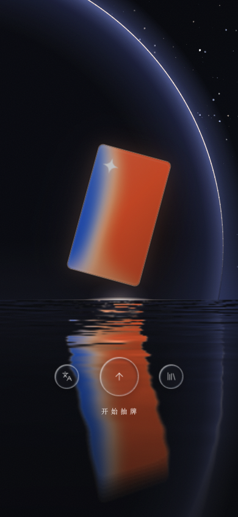

<h1 align="center"><picture><source media="(prefers-color-scheme: dark)" srcset=".github/brand/icon-dark.svg"></picture><br>Frankie Tarot</h1>

<p align="center"><b>在安静的空间里选牌、揭开牌阵，围绕一个问题展开思考。</b></p>

<p align="center"><a href="https://songhaifan.github.io/frankie-tarot/zh/">项目介绍</a> · <a href="https://tarot.songhai.site">打开应用</a> · <a href="docs/guide.md">使用指南</a> · <a href="README.md">English</a></p>

<p align="center"></p>

## 可以做什么

- 选择牌阵，在交互牌桌上手动选牌。
- 在牌库中浏览画作、卡包与牌背。
- 揭开解读，并返回该次解读的私密恢复状态。

## 本地运行

```sh
npm ci
npm run dev
```

应用默认使用 `https://tarot-api.songhai.site`。公共服务地址选项见 `.env.example`。

## 开始之前

应用自行管理正逆位与解读状态，不使用 API 的随机抽牌端点。选牌或翻牌不会请求 AI 解读；解读只在用户明确操作后开始。

## 开发说明

```sh
npm run typecheck
npm run build:vercel
npm run mcp:test
npm run test:interaction
npm run test:vercel
```

项目指南包含 MCP 预览配置与浏览器验收步骤。

[项目指南](docs/guide.md) · [Banner 维护](docs/readme/README.md)

---

<!-- series-footer:start -->

<p align="center">
<a href="https://songhaifan.github.io/frankie-brain/"></a> &nbsp; <a href="https://songhaifan.github.io/frankie-brain-ios/"></a> &nbsp; <a href="https://songhaifan.github.io/frankie-cards/"></a> &nbsp; <a href="https://songhaifan.github.io/frankie-dictionary/"></a> &nbsp; <a href="https://songhaifan.github.io/frankie-generative-art/"></a> &nbsp; <a href="https://songhaifan.github.io/frankie-goal/"></a> &nbsp; <a href="https://songhaifan.github.io/frankie-guitar/"></a> &nbsp; <a href="https://songhaifan.github.io/frankie-list/"></a> &nbsp; <a href="https://songhaifan.github.io/frankie-mbti/"></a> &nbsp; <a href="https://songhaifan.github.io/frankie-onitama/"></a> &nbsp; <a href="https://songhaifan.github.io/frankie-owspace-api/"></a> &nbsp; <a href="https://songhaifan.github.io/frankie-poker/"></a> &nbsp; <a href="https://songhaifan.github.io/frankie-stocks/"></a> &nbsp; <a href="https://songhaifan.github.io/frankie-tarot/"></a> &nbsp; <a href="https://songhaifan.github.io/frankie-tarot-api/"></a> &nbsp; <a href="https://songhaifan.github.io/frankie-werewolf/"></a>
</p>

<p align="center"><sub>Frankie series · Made by <a href="https://github.com/SonghaiFan">Songhai Fan</a></sub></p>

<!-- series-footer:end -->

<p align="right"><picture><source media="(prefers-color-scheme: dark)" srcset=".github/brand/signature-dark.svg"></picture></p>
